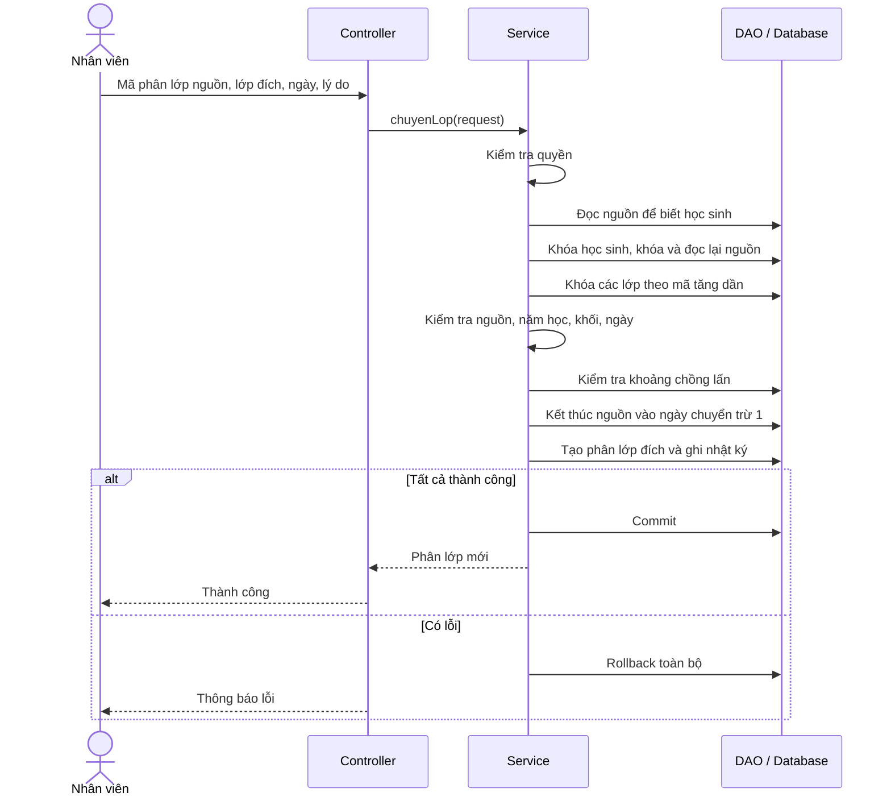

# Xếp lớp lần đầu và chuyển lớp trực tiếp

Đây là hướng dẫn cho phiên bản đang được triển khai trong source, cập nhật 08/11/2026.

## Chuẩn bị và chạy

1. Dùng MySQL 8.0.16 trở lên và Java 21 trở lên.
2. Database phải có cấu trúc trong `database/highschool_management_v2.sql`. File này dựng mới 23 bảng, không phải migration cho dữ liệu cũ. Không chạy lại vào schema đã có bảng.
3. Nếu cần dữ liệu minh họa, chạy `database/seed_v2.sql` một lần trên database mới. Tài khoản demo: `demo_giaovu` hoặc `demo_bgh`, mật khẩu `Test@12345`.
4. Source hiện trỏ tới `highschool_management_v2` trong `application.yaml`. Điều chỉnh cấu hình kết nối nếu dùng tên khác.
5. Chạy `./mvnw.cmd spring-boot:run`, mở `http://localhost:8080/login.html`.

Backend mới không tương thích bảng xếp lớp chờ duyệt cũ. Bộ SQL cũ trong exports/backups được giữ làm tài liệu lịch sử. Không có thao tác chuyển đổi hoặc ghi vào MySQL thật được chạy trong lần sửa code này.

## Luồng trên giao diện

- Vào **Xếp lớp & chuyển lớp**, chọn **Xếp lớp**. Chọn năm học, tìm học sinh chưa từng có phân lớp trong năm đó, chọn khối, lớp và ngày bắt đầu.
- Chọn **Chuyển lớp**, chọn năm học, học sinh và ngày chuyển. Giao diện tìm lớp tại ngày chuyển, tự chọn khối nguồn và lọc các lớp đích cùng khối. Nhập lý do rồi thực hiện.
- Có thể mở chuyển lớp từ danh sách học sinh trong lớp.
- **Lịch sử** hiển thị tên lớp, năm học, từ/đến ngày, lý do kết thúc, người và thời điểm tạo phân lớp.
- Các thao tác xếp/chuyển dành cho ADMIN, BGH và GIAO_VU; danh tính luôn được xác định từ JWT.

## Quy tắc thời gian

`TuNgay` và `DenNgay` đều tính cả ngày được lưu. Chuyển 15/10 thì nguồn kết thúc 14/10, đích bắt đầu 15/10. `DenNgay = NULL` là chưa kết thúc, nhưng khi xem danh sách phải giới hạn thêm khoảng năm học.

Giữ quy định cũ: không nhập ngày hiệu lực quá khứ. Ngày chuyển phải sau ngày bắt đầu nguồn. Sửa nhầm cùng ngày không thuộc chức năng chuyển lớp.

Xếp lần đầu bị chặn nếu đã có bất kỳ phân lớp nào trong năm học, kể cả lớp tương lai hoặc lớp đã kết thúc. Năm học khác không bị chặn bởi nguồn cũ có ngày kết thúc NULL.

Chỉ chuyển bản ghi nguồn đang mở. Nguồn đã có ngày kết thúc/lịch chuyển được lập trước bị chặn để không ghi đè lịch. Đích phải hoạt động, khác nguồn, cùng khối và năm học. Không giới hạn sĩ số.

ERD hiện chưa có trạng thái học sinh: bản này kiểm tra học sinh tồn tại; không tự tạo các trạng thái nghỉ học/chuyển trường chưa được nhóm quy định.

## API

| API | Mục đích |
| --- | --- |
| POST `/api/v1/enrollments` | Xếp lần đầu trực tiếp |
| POST `/api/v1/enrollments/transfers` | Chuyển trực tiếp |
| GET `/api/v1/enrollments?maNamHoc=1&tuKhoa=HS` | Danh sách phân lớp có phân trang |
| GET `/api/v1/enrollments/{id}` | Chi tiết phân lớp |
| GET `/api/v1/enrollments/students?maNamHocChuaXep=1` | Học sinh chưa có phân lớp trong năm |
| GET `/api/v1/enrollments/students?tuKhoa=HS` | Tìm học sinh thông thường |
| GET `/api/v1/students/{id}/enrollments` | Lịch sử |
| GET `/api/v1/classes/{id}/students?ngay=2026-11-08` | Danh sách theo ngày |

Xếp lớp:
```json
{"maHocSinh":1,"maLop":1,"tuNgay":"2026-11-08"}
```
Chuyển lớp (mã nguồn lấy từ response/lịch sử):
```json
{"maXepLopHienTai":1,"maLopDich":2,"ngayChuyen":"2026-11-15","lyDo":"Chuyển theo nguyện vọng"}
```
Không gửi mã người thực hiện hay thời điểm thực hiện. Các API approval/rejection được gỡ. Response không còn các thuộc tính trạng thái duyệt.

Lỗi: 400 dữ liệu/ngày sai; 401 chưa đăng nhập; 403 thiếu quyền; 404 không tìm thấy dữ liệu; 409 xung đột nghiệp vụ.

## Cách đọc code

Đọc lần lượt: Model/DTO → EnrollmentDao → EnrollmentDaoImpl → EnrollmentServiceImpl → EnrollmentController → school.js.

Các DTO xếp/chuyển, response phân lớp và khoảng năm học dùng class thông thường, constructor/getter/setter. Các record dùng chung có sẵn ở module khác không bị thay đổi.

DAO dùng SQL có tham số. Model chứa các thuộc tính hiển thị được JOIN từ học sinh/lớp/năm/tài khoản, tránh giao diện phải tra tên riêng từng dòng. Mapper chỉ chuyển dữ liệu, không tạo lại thời điểm thao tác.

## Transaction chuyển lớp



Khóa học sinh trước cả khi xếp lần đầu để tránh hai người cùng vượt qua kiểm tra chưa có lớp. Khóa nguồn chỉ khóa bảng xep_lop, tránh khóa thêm lớp/tài khoản qua JOIN. Tất cả thao tác ghi nằm trong một transaction READ_COMMITTED. Nhật ký ghi người chuyển; người tạo nguồn vẫn được giữ nguyên.

## Kiểm thử

- `./mvnw.cmd test`: test Java trên H2 tách biệt, bao gồm xác thực, khoảng ngày đóng, tương lai, năm học khác, sai khối/lớp đóng, đồng thời, rollback khi thêm đích hoặc ghi nhật ký lỗi.
- `node --check src/main/resources/static/js/school.js`: kiểm tra cú pháp JavaScript.
- `src/test/js/class-placement-ui.cjs`: kiểm thử DOM với jsdom và API thật trên ứng dụng H2 tại port 18080. Xem comment đầu file để cài dependency thử nghiệm vào thư mục target.

Kiểm thử DOM xác minh luồng thao tác và dữ liệu; không thay thế kiểm tra hình ảnh/responsive trong trình duyệt. H2 không thay thế kiểm chứng khóa trên MySQL triển khai.
